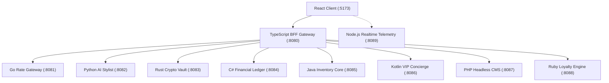

# CLOTHYYY.COM — Polyglot Microservices API Routing Matrix

This document provides a comprehensive mapping of all ten backend microservices and the frontend client, detailing communication protocols, default ports, health check URIs, and primary responsibilities.

---

## 1. Port Allocation Matrix

| Service | Language & Framework | Port | Protocol | Health Check | Primary Purpose |
| :--- | :--- | :--- | :--- | :--- | :--- |
| **BFF Gateway** | TypeScript / Express | `8080` | HTTP / JSON | `/health` | Polyglot orchestration, CSP, security headers |
| **Currency Rate Gateway** | Go 1.22 / Standard Lib | `8081` | HTTP / JSON | `/health` | High-frequency exchange rates & token bucket |
| **AI Stylist Engine** | Python 3.11 / FastAPI | `8082` | HTTP / JSON | `/health` | Visual embedding similarity, dynamic pricing |
| **Crypto Vault** | Rust 1.77 / Actix-Web | `8083` | HTTP / JSON | `/health` | Zero-allocation cryptographic seals & proofs |
| **Financial Ledger** | C# 12 / .NET 9 ASP.NET | `8084` | HTTP / JSON | `/health` | ZATCA Phase 2 compliance & statutory ledger |
| **Inventory Core** | Java 21 / Virtual Threads | `8085` | HTTP / JSON | `/health` | Atomic reservation & optimistic concurrency |
| **VIP Concierge** | Kotlin 1.9 / Ktor | `8086` | HTTP / JSON | `/health` | Private salon scheduling & tailor allocation |
| **Headless CMS** | PHP 8.3 / REST API | `8087` | HTTP / JSON | `/health` | Luxury editorials & multilingual metadata |
| **Loyalty Engine** | Ruby 3.3 / Sinatra | `8088` | HTTP / JSON | `/health` | Royal Black VIP tier multipliers & perks |
| **Realtime Streamer** | JavaScript / Node.js WS | `8089` | HTTP / WS | `/health` | Boutique live telemetry & visitor analytics |
| **Client Frontend** | TypeScript / Vite / React | `5173` | HTTP / SPA | `/` | Luxury user interface & polyglot console |

---

## 2. Inter-Service Communication Flow

---

## 3. SLA & Performance Benchmarks

- **P99 Target**: `< 5ms` on internal mesh; `< 50ms` at client boundary.
- **Failover Strategy**: Circuit breaker fallback with stale-while-revalidate caching on exchange rates and CMS editorial articles.
